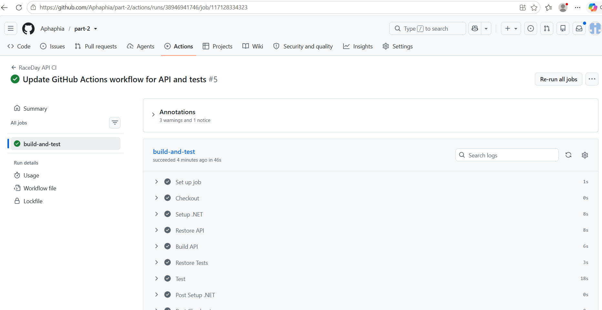

# RaceDay API (PROG6212 – Part 2)

A RESTful ASP.NET Core Web API for the RaceDay event management system. It supports two roles Organisers and Participants with JWT authentication, event and category management, enrolments, and race results.

## Tech Stack

ASP.NET Core 8 Web API, C#, Entity Framework Core (Code-First), SQL Server, JWT Authentication, BCrypt password hashing, Swagger / Swashbuckle, xUnit + Moq for unit tests, and GitHub Actions for CI/CD.

## Roles

Organisers can create, update, and delete their own events and categories, view enrolments for their events, and capture or correct race results. Participants can browse events, enrol in a category, cancel their enrolment, and view their own results.

## Setup

Clone the repository:

    git clone https://github.com/Aphaphia/part-2.git
    cd part-2

Configure the connection string in RaceDay.API/appsettings.json:

    "ConnectionStrings": {
      "DefaultConnection": "Server=(localdb)\\mssqllocaldb;Database=RaceDayDb;Trusted_Connection=True;MultipleActiveResultSets=true"
    }

Install the EF Core CLI tool once per machine:

    dotnet tool install --global dotnet-ef

Create the database (run from the RaceDay.API folder):

    dotnet ef database update

Run the API:

    dotnet run

Then open Swagger at https://localhost:<port>/swagger to test all endpoints.

## Tests

Run the test suite with:

    dotnet test

Tests cover user registration, login, duplicate email rejection, role-based access enforcement, event ownership, and enrolment validation.

## CI/CD

A GitHub Actions workflow at .github/workflows/dotnet.yml builds the API and runs all unit tests on every push to main. The build is currently passing.

## Endpoints

Authentication: POST /api/auth/register and POST /api/auth/login (public).

User Profile: GET and PUT /api/users/{userId}/profile (owner only).

Events: GET /api/events and GET /api/events/{eventId} are public. POST /api/events, PUT /api/events/{eventId}, and DELETE /api/events/{eventId} require the Organiser role and ownership of the event.

Categories: GET /api/events/{eventId}/categories is public. POST /api/events/{eventId}/categories, PUT /api/categories/{categoryId}, and DELETE /api/categories/{categoryId} require the Organiser role and ownership of the parent event.

Enrolments: GET /api/enrollments/my is for Participants. GET /api/events/{eventId}/enrollments is for the Organiser who owns the event. POST /api/enrollments is for Participants. PUT /api/enrollments/{enrollmentId}/status is for the Participant who owns the enrolment.

Results: GET /api/results/my is for Participants. GET /api/enrollments/{enrollmentId}/result is for the Participant or Organiser. POST /api/results and PUT /api/results/{resultId} are for Organisers.

## Demo

A full walkthrough of the API is available on YouTube: https://youtu.be/T__3VhSz5Fw

The video demonstrates the running API, the code structure, all endpoints in Swagger, JWT authentication with role-based access, and the unit tests running both locally and through GitHub Actions.

## Links

GitHub repository: https://github.com/Aphaphia/part-2.git

YouTube demo: https://youtu.be/T__3VhSz5Fw

## References

Microsoft. (2026). ASP.NET Core, Entity Framework Core, and SQL Server documentation. Microsoft Learn.

GitHub. (2026). GitHub Actions documentation. GitHub Docs.ssss
